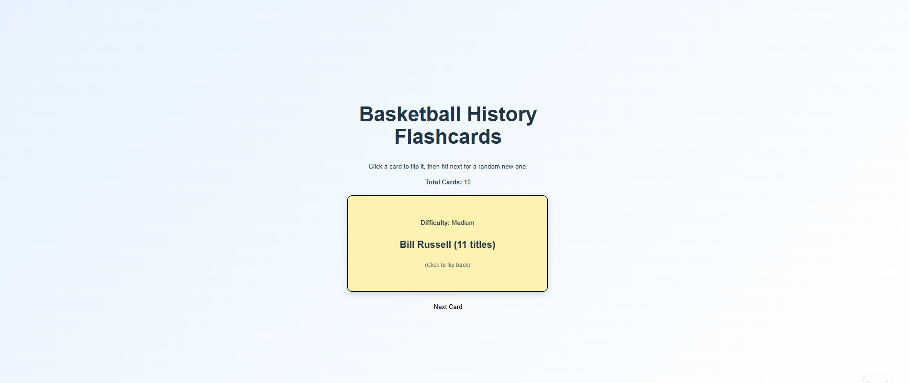

# Web Development Project 2 - Basketball History Flashcards 

Submitted by: Nadav Naim Z23805957

This web app is a flashcard application about basketball history. 
Users can view flashcards, see questions and answers, and navigate randomly through the card set.

Time spent: 5 hours

## Required Features

The following required functionality is completed:

- [x] The app displays the title of the card set, a short description, and the total number of cards
  - [x] Title of card set is displayed 
  - [x] A short description of the card set is displayed 
  - [x] A list of card pairs is created
  - [x] The total number of cards in the set is displayed 
  - [x] Card set is represented as an array of dictionaries containing question and answer pairs

- [x] A single card at a time is displayed**
  - [x] Only one half of the information pair is displayed at a time

- [X] Clicking on the card flips the card over, showing the corresponding component of the information pair
  - [X] Clicking on a card flips it over
  - [X] Clicking on a flipped card again flips it back

- [x] Clicking on the next button displays a random new card

## The following optional features are implemented:

- [ ] Cards contain images in addition to or in place of text

- [x] Cards have different visual styles such as color based on their category
  - Difficulty levels: Easy / Medium / Hard

## The following additional features are implemented:

* Basketball history themed flashcards

## Video Walkthrough

Here's a walkthrough of implemented required features:

GIF created with ScreenToGif (Windows)

## Notes

I had troubleshooting with the card flip interaction but I solved it after a while.

## License

  Copyright [2026] [Nadav Naim]

    Licensed under the Apache License, Version 2.0 (the "License");
    you may not use this file except in compliance with the License.
    You may obtain a copy of the License at

        http://www.apache.org/licenses/LICENSE-2.0

    Unless required by applicable law or agreed to in writing, software
    distributed under the License is distributed on an "AS IS" BASIS,
    WITHOUT WARRANTIES OR CONDITIONS OF ANY KIND, either express or implied.
    See the License for the specific language governing permissions and
    limitations under the License.